# 12 V to 3.3 V Buck Converter

  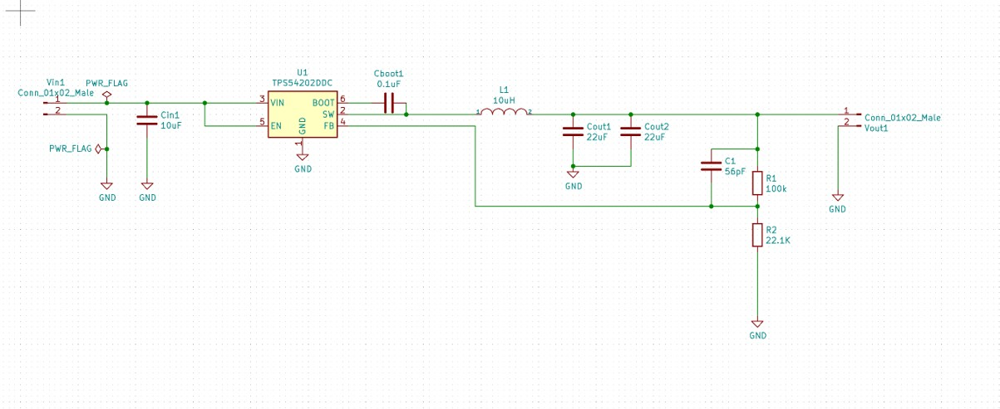

  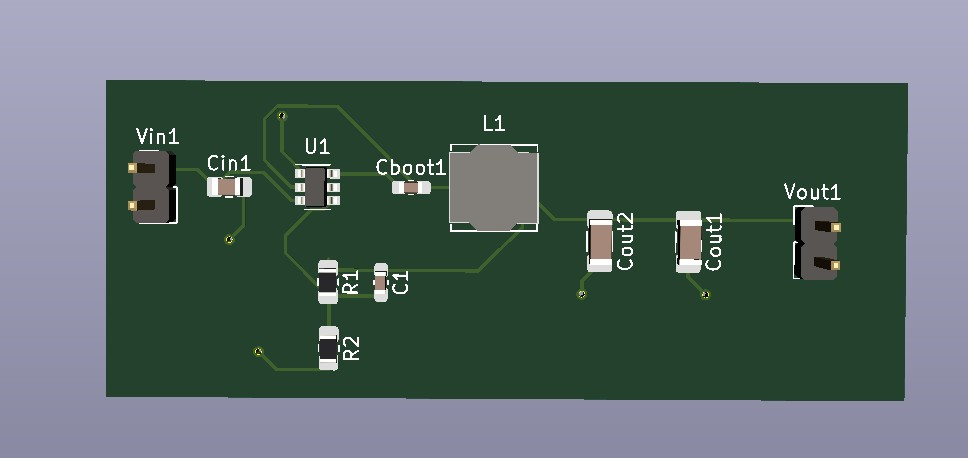

A 12 V to 3.3 V, 2A buck converter, designed in three steps. 
I started by researching how a buck converter works, and moved on to the hand calculations (duty cycle, inductor, output capacitor)
I then simulated it in LTspice, going from a simple diode version to a synchronous one with real MOSFETs. 
I then designed the schematic and PCB in KiCad around the TI TPS54202 regulator.

## Files

- `ltspice/Buck_ideal.asc`: buck with ideal switches
- `ltspice/Buck_real.asc`: same circuit with real MOSFETs
- `kicad/Buck.pro`: KiCad project (open this one)
- `kicad/Buck.sch`: schematic
- `kicad/Buck.kicad_pcb`: PCB layout

## Hand calculations

**Specifications:** Vin = 12 V, Vout = 3.3 V, Iout = 2A, fsw = 500kHz, output ripple ≤ 0.5 % of Vout (16.5 mV).

**Duty cycle**

D = Vout / Vin = 3.3 / 12 = 0.275

**Inductor**

I chose an inductor ripple current of ΔIL = 0.6 A (30 % of the 2 A load):

L = Vout · (1 − D) / (ΔIL · fsw) = 3.3 × 0.725 / (0.6 × 500 kHz) ≈ 8 µH

**Output capacitor**

Cout ≥ ΔIL / (8 · fsw · ΔVout) = 0.6 / (8 × 500 kHz × 16.5 mV) ≈ 9.1 µF

**Load resistor (for the simulation)**

Rload = Vout / Iout = 3.3 / 2 = 1.65 Ω

## LTspice simulation

### Normal diode

First version: switch S1, a normal diode, L = 10 µH, C = 22 µF and a 1.65 Ω load. Vin is 12 V and the switch is driven at 500 kHz.

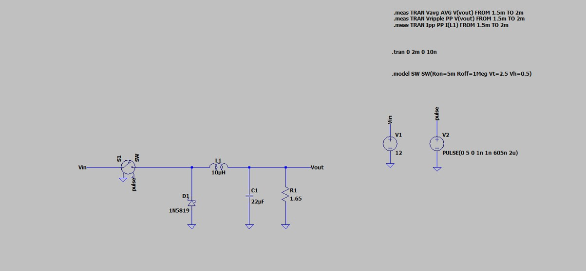

Waveforms of Vin, Vout and the inductor current IL:

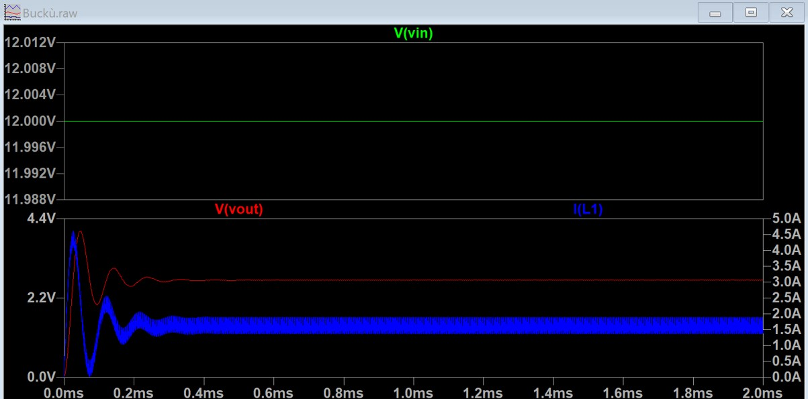

The output is only **2.69 V** instead of 3.3 V, because the diode voltage drop is too high.

### Schottky diode

I researched how to reduce the drop and replaced the diode with a Schottky (1N5819). The output improved to **2.96 V**.

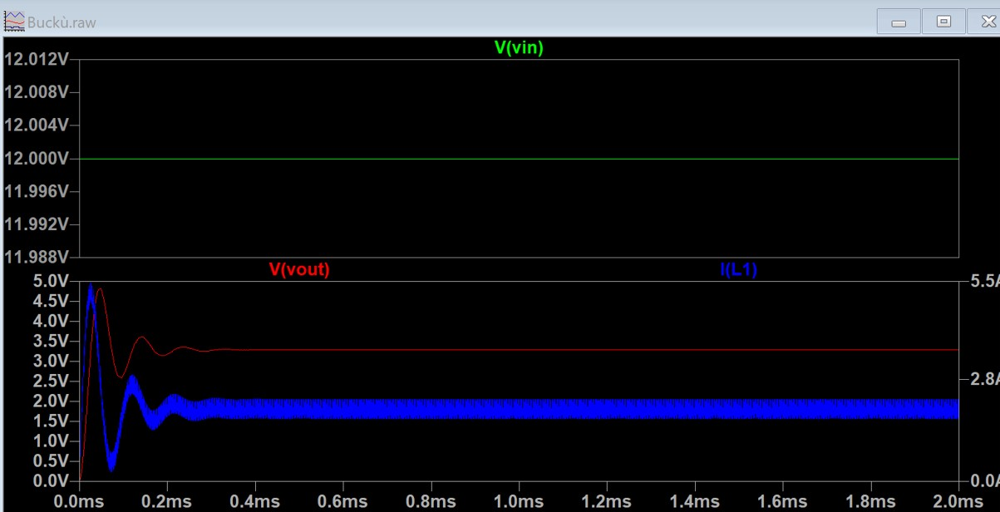
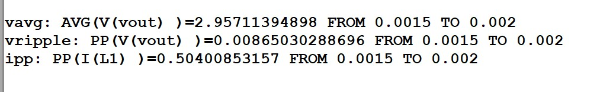

### Adjusting the duty cycle

To get back to 3.3 V, I redid the duty cycle estimate with the diode drop (about 0.47 V):

3.3 = 12 × D − (1 − D) × 0.47, so D ≈ 0.30 and Ton ≈ 605 ns

This gives **3.29 V**.

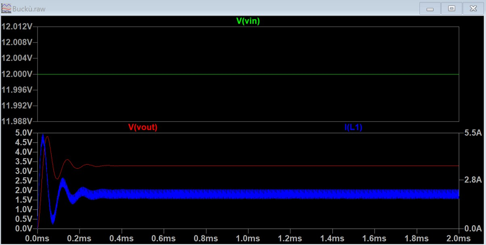
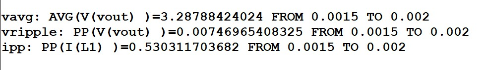

The diode still wastes about 0.6 W (0.47 V × 1.3 A average diode current), roughly 10 % of the output power.

### Synchronous version (second switch)

To reduce the loss further, I replaced the diode's job with a second switch S2 in parallel with it.

- When S1 opens, the inductor current has to keep flowing, and it needs a path to ground. That path used to be the diode.
- With S2 closed during the off-time, the current flows through S2 instead.
- Diode path: 0.47 V × 1.3 A ≈ 0.6 W
- S2 path: about 2² × 0.02 Ω × 0.7 ≈ 0.06 W

S1 and S2 must never be on at the same time, otherwise they short Vin to ground. So I added a **20 ns dead time** between them. The diode stays in parallel to carry the current during these short gaps.

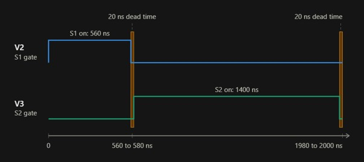
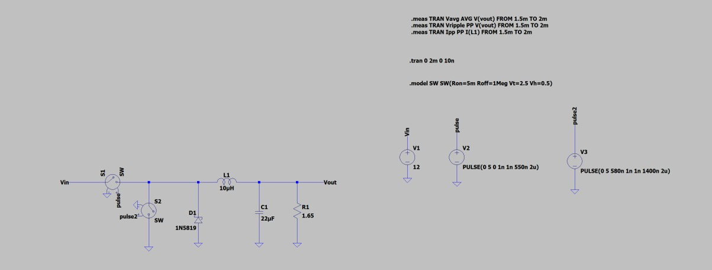

Results:

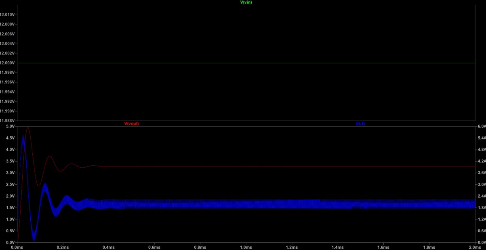
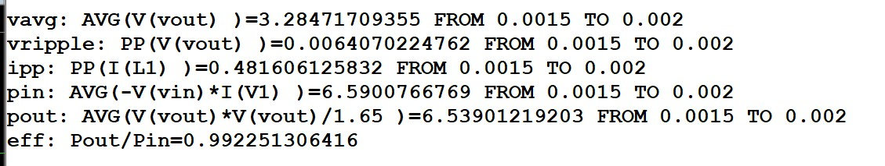

### Summary 

| | Normal diode | Schottky | Schottky, Ton = 605 ns | Synchronous |
|---|---|---|---|---|
| Average Vout | 2.69 V | 2.96 V | 3.29 V | 3.28 V |
| Ripple | 5.8 mV | 8.7 mV | 7.5 mV | 6.4 mV |
| Efficiency | **81.5 %** | **89.6 %** | **90.6 %** | **99.2 %** |

We now have a working simulation with a good efficiency (**99.2 %**).
However, this is still the ideal case, with perfect switches, so this number is sure to drop with real components.

### Real MOSFETs (N-channel)

Next, I replaced the ideal switches with real N-channel MOSFETs (Si7336ADP). The Schottky diode stays in parallel to carry the current during the dead time.

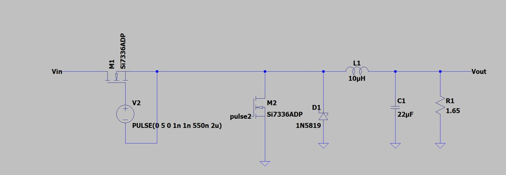

**Why N-channel:** an NMOS has a lower Rds(on) than a PMOS of the same size, so it wastes less power. The catch is that the high-side NMOS (M1) needs its gate voltage to be higher than its source, and its source is the switch node, which jumps between 0 V and 12 V. So the gate source V2 is placed between the gate and the switch node. It gives a 5 V gate-to-source voltage whatever the switch node does. The low-side MOSFET (M2) has its source on ground, so its gate source is simply referenced to ground.

Results:

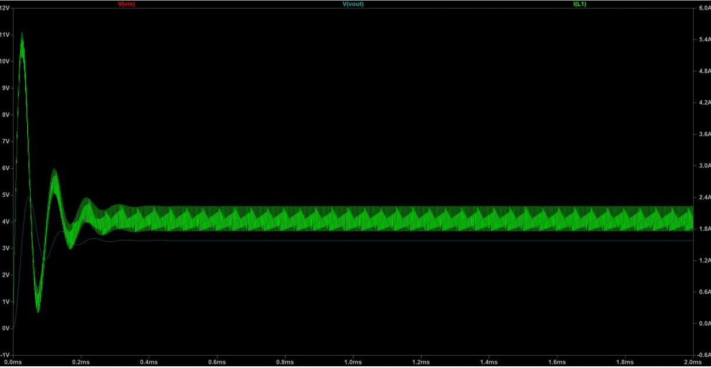
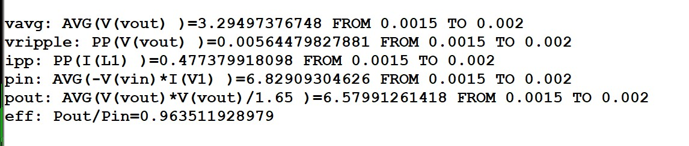

| | Ideal switches | Real MOSFETs |
|---|---|---|
| Average Vout | 3.285 V | 3.295 V |
| Ripple | 6.4 mV | 5.6 mV |
| Pin | 6.59 W | 6.83 W |
| Pout | 6.54 W | 6.58 W |
| Efficiency | 99.2 % | **96.4 %** |

As expected, the efficiency dropped. This is due to the internal resistance of the MOSFETS and the MOSFET capacitances

The output voltage and ripple stay on target, so the design still works with real components.

## KiCad schematic and PCB

For the board I used the TI **TPS54202** (4.5–28 V input, 2 A, fixed 500 kHz). It has the high-side and low-side switches built in (148 mΩ and 78 mΩ), so the two MOSFETs and their gate drive from the simulation are replaced by a single chip. The simulation still tells me what to expect: a synchronous buck at 500 kHz with real MOSFET resistances.

### Choosing the components

I took the component values from the datasheet.

**Output voltage divider.** The output voltage is set by two resistors from Vout to the FB pin (datasheet section 6.3.8), with a 100 kΩ upper resistor as recommended:

Vout = Vref × (1 + R_top / R_bottom), with Vref = 0.596 V

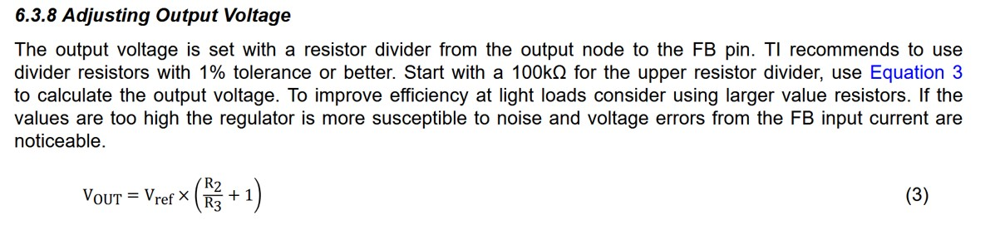
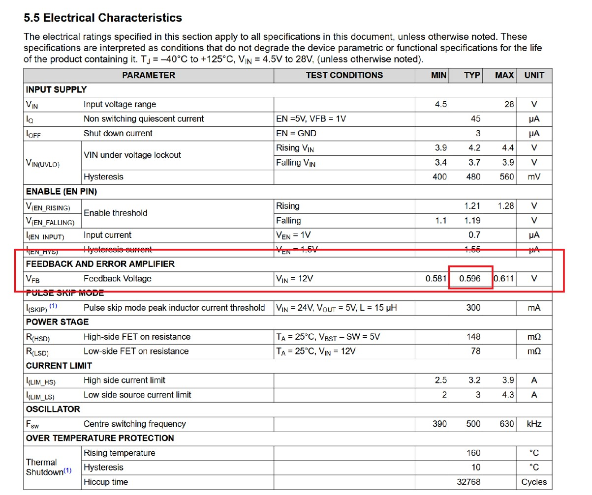

For 3.3 V, the datasheet gives R_top = 100 kΩ and R_bottom = 22.1 kΩ:

Vout = 0.596 × (1 + 100 / 22.1) = 3.29 V

**Other components.** Table 7-2 of the datasheet gives the recommended values for 3.3 V:

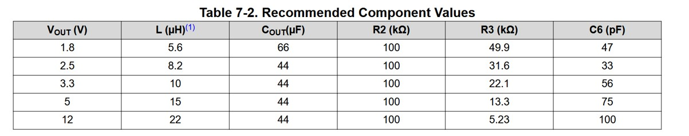

| Part | Value | Role |
|---|---|---|
| L1 | 10 µH | Inductor, gives about 0.48 A of ripple current |
| Cout1 + Cout2 | 2 × 22 µF = 44 µF | Output capacitor, keeps the ripple low |
| C1 | 56 pF | Across the upper divider resistor, helps the loop stability |
| Cboot | 0.1 µF | Between BOOT and SW, powers the gate drive of the high-side switch (same floating-gate problem as in the simulation) |
| Cin | 10 µF | Input capacitor, supplies the pulsed input current |

### Schematic

### PCB

I placed the parts around the TPS54202 and routed a two-layer board.
The bottom layer is a solid ground plane, connected to the GND pads through vias. The board outline is drawn on the Edge.
Cuts layer, and the design passes the KiCad design rule check (DRC) with no errors.

Layout choices, following the datasheet's layout guidelines:

- The input capacitor (Cin) and the bootstrap capacitor (Cboot) sit right next to the IC, and the switch-node trace between U1 and L1 is kept short.
- The output capacitors are placed right after the inductor.
- The feedback divider (R1, R2, C1) is placed away from the switch node and takes its voltage from the output, so the switching noise does not disturb the FB pin.

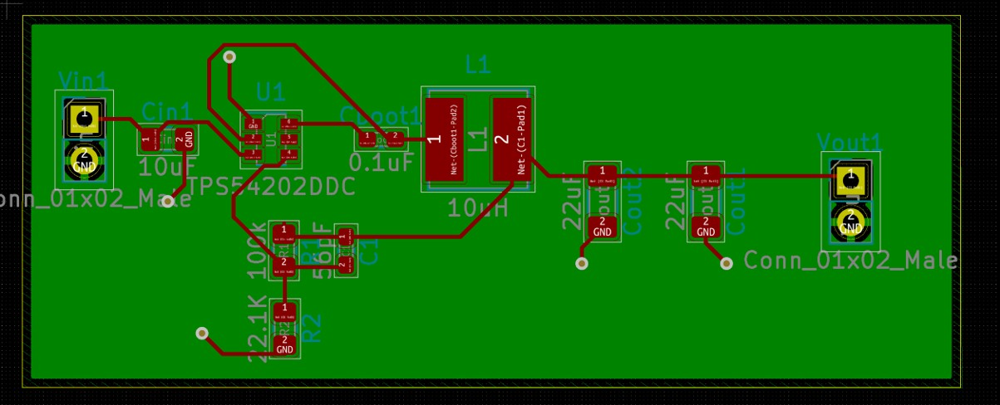

3D views:

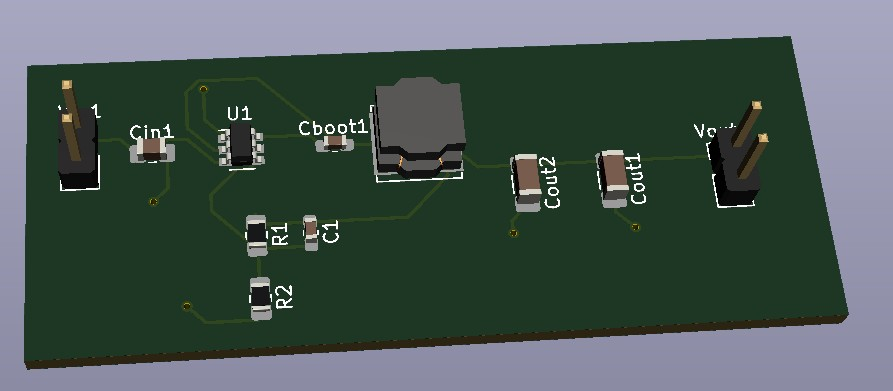
